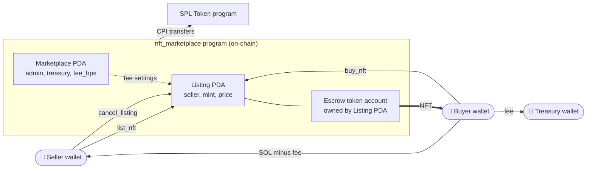
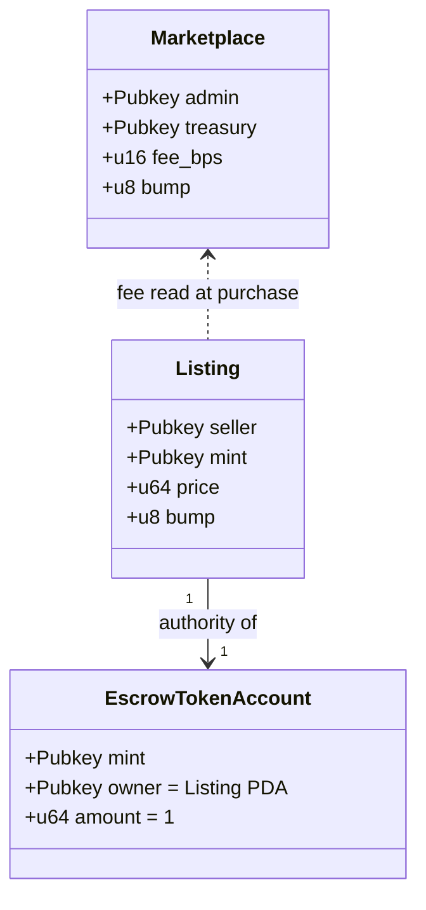
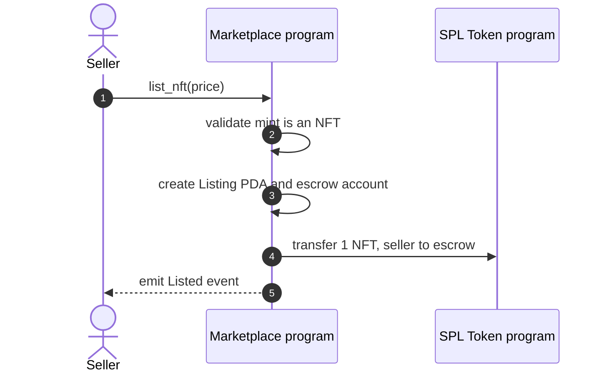
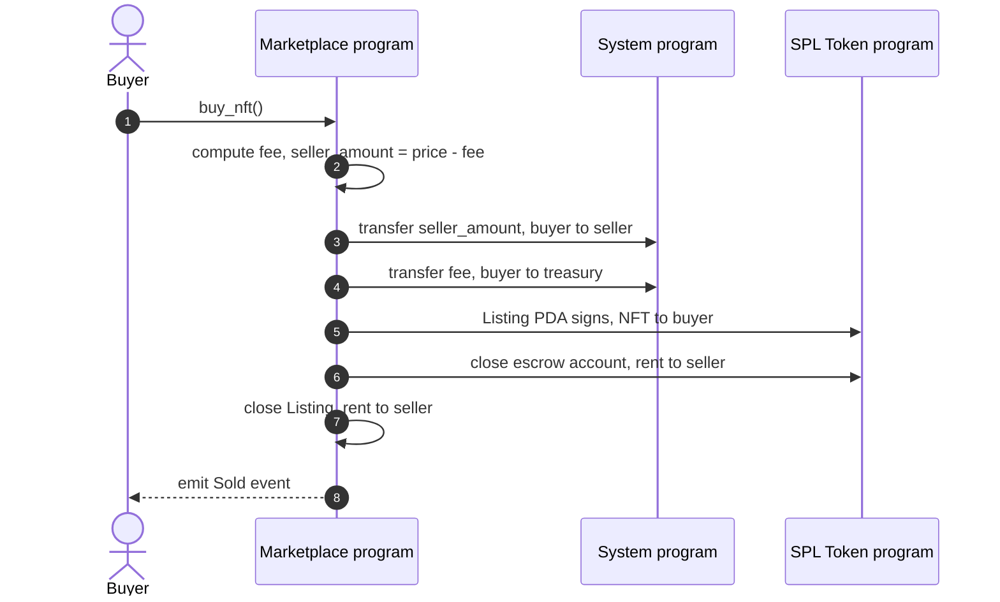
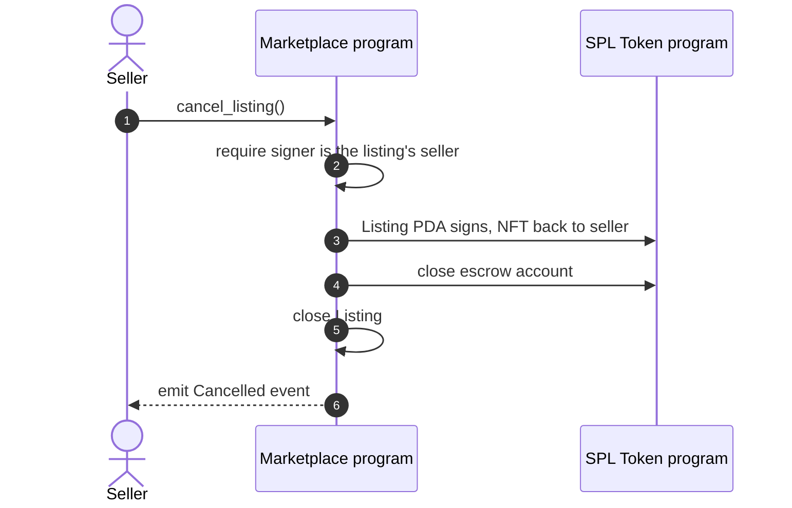
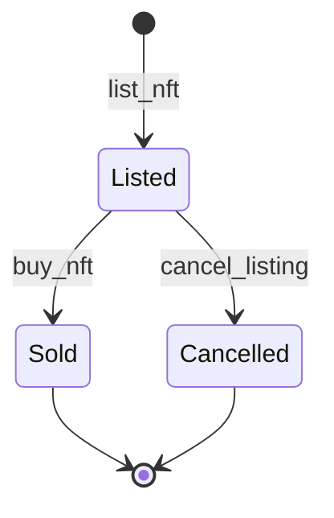

# 🛒 NFT Marketplace: Solana Escrow Program

> A trustless NFT marketplace built with Anchor. Sellers list an NFT at a SOL price, buyers purchase it in a single atomic transaction, and a program-owned escrow guarantees that nobody, including the marketplace, can run off with the NFT or the money.


---

## ✨ What it does

| Action | Who | What happens |
|---|---|---|
| **List** | Seller | NFT moves into an escrow token account owned by a program-derived address. A price in lamports is recorded. |
| **Buy** | Buyer | In one transaction: SOL goes to the seller, the fee goes to the treasury, and the escrow PDA signs the NFT over to the buyer. |
| **Cancel** | Seller | The escrow PDA returns the NFT and the listing is closed. Rent is refunded. |

If any part of a sale fails, the whole transaction reverts. There is no state where a buyer has paid but not received the NFT, or the reverse.

## 🏗️ System architecture



The program holds no private keys. Custody is enforced entirely by PDA signing.

## 🧩 Account model



### PDA derivation

| Account | Seeds | Notes |
|---|---|---|
| Marketplace | `["marketplace"]` | One per program deployment |
| Listing | `["listing", nft_mint]` | One active listing per NFT |
| Escrow token account | Associated token address of `(nft_mint, Listing PDA)` | Created at list time, closed on sale or cancel |

## 🔄 Instruction flows

### List



### Buy



### Cancel



### Listing lifecycle



## 💰 Fee model

```
fee           = price × fee_bps ÷ 10,000
seller_amount = price − fee
```

Example at the default 250 bps (2.5%) for a 1 SOL listing:

| Recipient | Amount |
|---|---|
| Seller | 0.975 SOL |
| Treasury | 0.025 SOL |
| Buyer pays | 1.000 SOL |

Fee maths runs in `u128` with checked operations, and the fee is capped at **1,000 bps (10%)** at initialization.

## 📚 Instruction reference

| Instruction | Arguments | Signer | Accounts touched |
|---|---|---|---|
| `initialize_marketplace` | `fee_bps: u16` | Admin | marketplace (init), treasury |
| `list_nft` | `price: u64` | Seller | mint, seller token account, listing (init), escrow (init) |
| `buy_nft` | none | Buyer | marketplace, treasury, seller, mint, listing (close), escrow (close), buyer token account |
| `cancel_listing` | none | Seller | mint, listing (close), escrow (close), seller token account |

### Events

| Event | Fields |
|---|---|
| `Listed` | seller, mint, price |
| `Sold` | seller, buyer, mint, price, fee |
| `Cancelled` | seller, mint |

### Errors

| Error | Raised when |
|---|---|
| `InvalidFee` | Fee above 10% |
| `InvalidPrice` | Price is zero |
| `NotAnNft` | Mint doesn't have 0 decimals and a supply of 1 |
| `MintAuthorityNotRevoked` | The mint could still create more tokens |
| `NftNotOwned` | Seller's token account doesn't hold the NFT |
| `MathOverflow` | A checked arithmetic operation failed |

## 🛡️ Security design

| Threat | Mitigation |
|---|---|
| Listing a fungible token as an "NFT" | Requires `decimals == 0` and `supply == 1` |
| Listing an NFT whose supply could be inflated | Requires the mint authority to be revoked |
| A stranger cancelling someone's listing | `Signer` plus `has_one = seller` on the listing |
| Fees redirected to another wallet | `has_one = treasury` on the marketplace account |
| Payment sent to a different seller | `has_one = seller` on the listing |
| Buyer token account for the wrong mint or owner | `token::mint` and `token::authority` constraints |
| Fee overflow or underflow | `u128` intermediate maths, checked operations, 10% cap |
| Replaying a sale | Listing and escrow are closed in the same transaction |
| Stranded rent | Closed accounts refund lamports to the seller |

### Known limitations

- **SOL payments only.** SPL-token pricing is a planned extension.
- **No royalties yet.** Creator royalties need Metaplex metadata parsing (see roadmap).
- **No price updates.** To change a price, cancel and relist.
- **Fixed fee.** There is no `update_fee` instruction yet.
- **Buyer token account must exist.** The client creates it in the same transaction.
- **Not audited.** This is a portfolio project. Don't use it with real funds.

## 🧪 Test suite

Seven integration tests run against a live local validator (Surfpool), using real SPL token mints rather than mocks.

| Test | Verifies |
|---|---|
| Rejects a fee above the maximum | Initialization guard |
| Initializes the marketplace | State is stored correctly |
| Lists an NFT into escrow | NFT moves, price and seller recorded |
| Rejects a non-NFT token | `NotAnNft` for a 6-decimal token |
| Sells an NFT | Exact fee to treasury, seller paid, NFT to buyer, accounts closed |
| Seller can cancel | NFT returned, listing and escrow closed |
| Non-seller cannot cancel | Attacker rejected, escrow untouched |

## 🚀 Getting started

### Prerequisites

- [Rust](https://www.rust-lang.org/tools/install)
- [Solana CLI](https://docs.solana.com/cli/install-solana-cli-tools)
- [Anchor CLI](https://www.anchor-lang.com/docs/installation) 1.x
- [Surfpool](https://docs.surfpool.run/): `curl -sL https://run.surfpool.run/ | bash`
- Node.js 18+

### Build and test

```bash
git clone <your-repo-url>
cd nft-marketplace
npm install
anchor build
anchor test
```

### Deploy to devnet

```bash
solana config set --url https://api.devnet.solana.com
anchor deploy --provider.cluster devnet
node init-marketplace.js     # one-time: creates the Marketplace PDA
```

> **Known toolchain issue:** on Anchor 1.1.x the deploy may end with `Failed to initialize IDL`. The program upgrade itself still succeeds (check with `solana program show`), and the client uses the local IDL file, so this is safe to ignore.

### 📍 Deployment

| Network | Program ID |
|---|---|
| Devnet | `E6CZ4yrxREvTUUjHz2hD4vAATW2yhKoFUTi1MKrXXp9F` |

## 📁 Project structure

```
nft-marketplace/
├── programs/
│   └── nft-marketplace/
│       └── src/lib.rs          # instructions, accounts, events, errors
├── tests/
│   └── nft-marketplace.ts      # integration tests
├── init-marketplace.js         # one-time devnet setup script
├── run-tests.js                # Mocha runner (ts-node, CommonJS)
├── Anchor.toml
└── Cargo.toml
```

## 🧰 Toolchain notes

Lessons from building on Anchor 1.x, in case they save you a day:

- The TypeScript SDK is now `@anchor-lang/core`, renamed from `@coral-xyz/anchor`.
- `CpiContext::new` takes the program's `Pubkey` (`.key()`), not its `AccountInfo`.
- `anchor-spl` needs its `idl-build` feature enabled alongside `anchor-lang`'s.
- `anchor test` defaults to Surfpool, which must be installed separately.
- Pinning `uuid` to 9.0.1 avoids a CommonJS/ESM crash in `rpc-websockets`.
- A small custom Mocha runner avoids ESM loader problems with `.ts` test files on Node 18.

## 🗺️ Roadmap

- [x] Escrow listing, purchase and cancel
- [x] Marketplace fee with on-chain cap
- [x] Events for indexers
- [x] Integration test suite
- [ ] Devnet deployment and marketplace initialization
- [ ] Angular frontend: browse, list, buy, cancel
- [ ] Metaplex metadata checks and creator royalties
- [ ] SPL-token pricing
- [ ] `update_price` and `update_fee` instructions
- [ ] Offers and auctions

## 📄 License

MIT

## 👤 Author

Built by Stephen as part of a hands-on Solana portfolio series, following a PDA token vault. Questions or feedback are welcome.